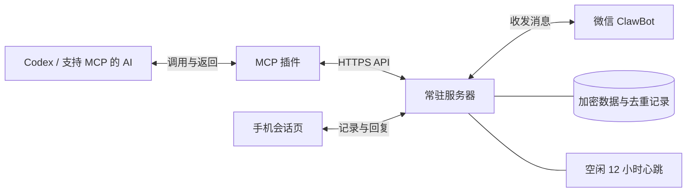

# Notify Bridge · 微信与飞书

新增机器人请先看 [新增飞书 Bot 操作指南](docs/server/新增飞书Bot操作指南.md)，包含后台逐步配置、发布和实机验收。

**通知桥：让 AI 或程序通过 MCP / HTTP API 向微信或飞书发送通知，并将文字回复与任务决定带回对应会话。**

管理页支持添加多个微信和飞书 Bot，为每把 Key 关联允许调用的 Bot 与默认 Bot。AI 或普通程序通过同一接口指定 `bot_id`，就能选择微信、飞书 A 或飞书 B；回复和任务决定进入统一会话。详见 [多 Bot 管理与 Key 授权](docs/server/BOTS.md)及[飞书配置](docs/server/FEISHU.md)。项目包名、微信插件身份和已有 `/wechat` 服务地址保持兼容。

核心用途是为 AI 和普通程序提供统一的通知与回复通道。在配置并授权的工作流中，AI 发现系统异常、任务失败，或遇到需要人工确认的问题时，可以调用 MCP 工具，将问题摘要和待处理事项发送到授权的微信或飞书 Bot，方便用户离开电脑后及时获知并跟进。异常检测与通知触发由接入的 AI 或监控流程负责，通知桥负责消息传递。

同时支持直接调用 HTTP API、读取微信与手机会话页回复，并由服务器管理空闲心跳。普通监控脚本、定时程序或其他应用也能接入，不要求调用方是 AI。

需要本人决定时，可以发送 [任务卡片](docs/server/TASK-CARDS.md)：微信提醒后，打开手机会话页选择方案或自行回复，决定自动回到对应应用。支持默认单选、按需多选、快捷确认、独立输入和轻量表单；普通通知仍只需调用 `sendMessage`。页面分别显示待答复、已答复、处理中和已完成，卡片界面仅在遇到卡片时渲染。

手机页提供 **待我处理、会话搜索、置顶、改名和草稿恢复**。改名保留历史与唤醒绑定；查看卡片不会代替提交答复。详见 [手机端日常使用](docs/mobile-experience.md)。

项目由服务端、Web 前端和独立 MCP 插件组成；普通程序也可以直接调用 HTTP API。

## 项目目录

仓库根目录是本 README 所在目录。父级工作区的私有配置、历史备份和交付文件不属于项目。

```text
notify-bridge/
├── frontend/        # Vue + Element Plus 前端工程
│   ├── src/         # admin、chat、oauth 与共享组件
│   └── tests/       # 前端契约测试
├── server/          # Python 服务、部署配置与测试
│   ├── src/wechat_bridge/
│   │   ├── api/     # HTTP 接口
│   │   ├── channels/# Bot 权限、路由及平台驱动
│   │   ├── services/# 业务逻辑
│   │   ├── storage/ # 数据与加密存储
│   │   ├── runtime/ # 生命周期
│   │   ├── mcp/     # 远程 MCP 与 OAuth
│   │   ├── wechat/  # 微信协议和配对
│   │   └── web/     # 构建生成的页面资源
│   ├── tests/
│   ├── scripts/    # 初始化与服务端运维工具
│   └── deploy/     # 反向代理等部署模板
├── mcp-plugin/      # 可独立分发的插件、Skill 与宿主接收器
├── examples/        # 普通程序接入示例
├── scripts/         # 项目构建、同步、检查和打包
├── docs/            # 维护、接口、操作及历史发布文档
├── .github/         # CI 检查
├── dist/            # 本地生成的交付包，不提交 Git
├── README.md        # 产品说明与快速开始
├── CONTRIBUTING.md  # 开发流程
└── SECURITY.md      # 安全边界
```

`frontend/node_modules`、Python 缓存和 `dist` 是本机构建产物，不是维护源码，也不会进入源码交付包。根目录 `pyproject.toml` 只配置代码格式；服务安装信息由 `server/pyproject.toml` 管理。

产品和源码目录统一称为 **Notify Bridge / 通知桥 / `notify-bridge`**。GitHub 仓库地址目前仍沿用历史名称；Python 包 `wechat-notify-bridge`、导入名 `wechat_bridge`、`WECHAT_*` 配置及旧客户端目录是兼容标识，不应仅为改名破坏现有部署。

## 维护交接

朋友接手维护请先读 [维护手册](docs/MAINTAINER.md)，目录导航见 [文档索引](docs/README.md)。前端源码在 `frontend/src/`；运行用静态资源由构建生成。

v0.3 整理升级候选版：统一管理端、共享会话、应用/Key 分离与管理员恢复，详见 [实施与验证](docs/product-v3/IMPLEMENTATION.md) 和 [管理、终端兜底及回退](docs/product-v3/OPERATIONS.md)。在独立升级分支验收，未经确认不部署正式服务。中转站不运行内部 Agent；Codex/Claude Code 是站外调用与维护助手。

三条交付路径：[部署维护](docs/MAINTAINER.md)、[AI 宿主 MCP 接入](docs/integration/AI-HOSTS.md)、[业务系统 HTTP 接入](docs/integration/HTTP.md)。AI/HTTP 资料可基于已有应用导出，不自动创建重复身份或轮换 Key。

## 开发者接入

接入其他 AI、监控脚本或业务程序，请从 [开发者接入指南](docs/integration/README.md) 开始。配套提供 [HTTP 接口文档](docs/server/API.md)、[OpenAPI 文件](server/openapi.json) 和 [轻量 Python 客户端示例](examples/python/notify_bridge.py)。

## 快速部署与使用

下面以 Linux 服务器、Docker Compose 和 `https://notify.example.com/bridge` 为例。请替换为自己的域名；示例地址不能直接使用。需要 Python 3.12、Git、Docker Compose、已配置域名与证书的 HTTPS 站点；使用微信时还需要手机微信中的 ClawBot 入口，纯飞书部署不需要微信。

### 1. 下载并初始化

```bash
git clone https://github.com/CosmicCrafter/wechat-notify-bridge.git notify-bridge
cd notify-bridge/server
python3 -m venv .venv
.venv/bin/python -m pip install .
.venv/bin/python scripts/prepare_secrets.py --web-pairing --base-url https://notify.example.com/bridge
cp .env.example .env
```

编辑 `server/.env`，将 `WECHAT_PUBLIC_BASE_URL` 改为与上面一致的实际 HTTPS 地址。初始化生成的 `.private/provisioned/` 包含私有密钥，不提交到 Git；管理员原始密钥位于 `.private/provisioned/admin/admin.json`。已有部署升级时保留原数据和密钥，**不要重新运行初始化命令**。

### 2. 启动并配置 HTTPS

仍在 `server/` 目录执行：

```bash
mkdir -p .data
sudo chown -R 10001:10001 .data .private/provisioned/secrets
sudo chmod 700 .data .private/provisioned/secrets
sudo chmod 600 .private/provisioned/secrets/*
docker compose up -d --build
docker compose ps
curl http://127.0.0.1:18092/health
```

将 [Nginx 配置示例](server/deploy/nginx.conf) 中的 location 配置放入已有 HTTPS 站点的 server 块，检查 `nginx -t` 通过后 reload。示例包含 `/wechat/` 和远程 MCP 所需的两个根级 OAuth discovery 路径，图片请求上限为 `6m`。容器默认仅监听本机 `127.0.0.1:18092`，外部客户端通过 HTTPS 访问。

### 3. 添加 Bot 并创建接入密钥

1. 打开 `https://你的域名/bridge/admin/`，使用初始化文件中的 `admin_key` 登录。管理员密钥只用于管理页面，不填到 AI 插件。
2. 在“Bot 管理”点击“新增 Bot”：微信按向导扫码绑定；飞书填写应用配置，并按回调配置步骤在飞书后台保存、发布。
3. 使用微信时，在 ClawBot 聊天框发送一句“测试”，让服务获取微信回复上下文。纯飞书部署不需要这一步。
4. 在“接入密钥”中为每个程序或 AI 创建独立密钥，选择允许调用的 Bot 和默认 Bot。微信 `/getkey codex` 仍可用于微信侧创建身份。

### 4. 把 MCP 接入 AI

**远程 MCP：** 在支持 Streamable HTTP 与 OAuth 的宿主中配置 `https://你的域名/bridge/mcp`。首次连接时在微信发送 `/web` 获取手机登录码，登录授权页面、选择刚创建的 AI 身份，再确认授权。远程模式无需将 API 密钥粘贴给 AI。

如果宿主支持本项目的插件包，可从项目根目录生成：

```bash
server/.venv/bin/python mcp-plugin/tools/build_remote_plugin.py \
  --base-url https://notify.example.com/bridge \
  --output dist/wechat-notify-remote.zip
```

**本机 stdio：** 从项目根目录执行 `python -m pip install -r mcp-plugin/requirements.txt`，将服务地址和该 AI 身份的密钥保存在私有 JSON 文件中：

```json
{
  "base_url": "https://notify.example.com/bridge",
  "api_key": "填入该客户端的密钥，按字符串保存"
}
```

将 [MCP 客户端配置示例](mcp-plugin/examples/mcp-client.json) 中的 Python、`http_bridge.py` 和私有配置文件路径改为本机绝对路径，再加入宿主的 MCP 配置。私有文件仅允许本人访问，不放入插件包或仓库。同一个宿主选择远程或本机一种方式，避免同名工具重复。

完整接入步骤见 [MCP 插件说明](mcp-plugin/README.md) 和 [远程授权说明](docs/server/REMOTE-MCP.md)。宿主需实际支持 MCP 工具调用；自动唤醒另见 [桌面接收器](mcp-plugin/DESKTOP-WAKE.md) 和 [云端事件](docs/server/MCP-EVENTS.md)。

### 5. 发出第一条通知

可对已接入 MCP 的 AI 说：

> 请查询微信通知工具的身份，为当前聊天登记简称“系统监控”，然后发送一条“微信通知接入测试”。本任务后续如果发现系统异常、任务失败或需要我确认的问题，请通过微信通知我，写明问题摘要和需要我做的事。

工具调用流程为 `getCallerIdentity` → `registerConversation` → `sendMessage` 或 `sendNotification`。保存登记返回的 `conversation_id`，后续收发、查回执都复用它；同一事件复用原 `dedup_key`，避免重复通知。以手机实际收到测试消息作为接入验收。

你可以直接在微信回复 `[codex-系统监控] 内容`，准确标签以 `/chats` 为准；也可以点击消息下方的会话链接查看完整记录并回复。微信 `/help` 查看指令，`/status` 查看接收状态、最近发送结果与恢复建议。

发送出现 `-2` 时，可先直接从微信 ClawBot 发一条新消息，再检查发送连接。网页回复不会刷新微信上下文，12 小时心跳也不能保证上下文一直有效。接口接受不等于手机收件，结果未知时先查原发送回执，不盲目重发。

主动推送还可能受微信的条数、时间窗口与限流约束。1.14.0 起显示本地已接受推送计数，并保存加密的失败诊断，避免把接收正常误当作通知可达；达到 8 条时提示可能接近额度。1.14.1 起消息底部显示剩余提示，例如 `(5/10)`；归零前直接在微信 Bot 发一句话即可刷新，不需要指定 AI。数字是根据实测十条预算的本地估算，不是微信查询返回的额度。排查与受控验证证据、回执字段及关键告警处理见 [推送可靠性](docs/server/DELIVERY-RELIABILITY.md)。

详细的备份、升级和故障处理见 [服务器部署说明](server/README.md)。

## 配置与运行数据

源码只提供 `server/.env.example`。首次部署复制为 `server/.env` 并填写自己的地址；真实 `.env`、数据库和密钥不随源码交付。数据位置、内容和备份方法见 [运行配置与数据存储](docs/server/CONFIGURATION.md)。

## 代理配置与私有信息

普通微信通知不要求配置 OpenAI 回调代理。只有启用了云端事件订阅，且服务器无法直连宿主回调地址时，才需要管理员自行提供合适的出站代理。

回调模块通过环境变量 `WECHAT_CALLBACK_PROXY_FILE` 读取管理员提供的只读 JSON 文件，示例见 [回调代理配置](docs/server/MCP-EVENTS.md#可选的回调代理164)。源码没有内置订阅地址、代理节点或真实账号密码；示例中的凭据均为占位符。订阅、节点、代理密码应放在服务器独立私有目录，不提交到 Git，也不打入源码或插件包。

该配置只作用于允许的宿主事件回调域名，不会将微信收发或所有服务流量自动切换到代理。标准 Compose 部署默认不启用它；具体的挂载、环境变量和内部代理连通要求见回调代理说明。

管理页提供代理管理：订阅定时更新、优先规则、手动选择、节点检测、流量/到期展示及失败回退。使用 `server/compose.proxy.yaml` 启用可选 Mihomo 容器，按 [订阅与代理管理部署步骤](server/README.md#可选admin-订阅与代理管理1100) 初始化私有配置；也可接入已有 Mihomo。`.env` 提供初始订阅和更新间隔，Admin 保存后以加密持久化设置为准。


## 工作方式



AI 发消息时调用插件；服务器持续接收微信回复，AI 可以按需读取。关闭电脑后，服务器仍可接收消息并管理心跳。也可以跳过 MCP，由其他程序直接调用 HTTP API。

## 已实现

- 部署后打开网页扫码绑定，查看连接状态与心跳时间；支持验证码和同账号重新绑定。
- 独立管理员密钥；AI 客户端无法生成二维码或修改绑定。
- 一个微信账号连接多个 AI 客户端，每个客户端独立密钥，消息自动标记真实来源。
- 微信 `/getkey`、`/list`、`/resetkey`、`/revoke`、`/rename`、`/status`、`/help` 与 Admin 页面共用客户端数据。
- Admin 支持确认后删除客户端密钥，保留历史消息；同名可重新创建。微信指令和管理页面统一使用北京时间（UTC+8）。
- 发送 Markdown 消息和结构化任务提醒，指令回复统一排版；收件人固定为本人。
- 消息附带手机会话链接，支持完整正文、双向记录、直接回复及读取状态，详见 [手机会话页](docs/server/CHAT.md)。
- 按游标读取微信和网页回复；不同客户端可以各自保存读取进度。
- 发送去重、结果查询、API 密钥鉴权。
- SQLite 持久化；微信凭据、上下文和会话双向正文加密存储。
- 收发后推迟 12 小时，持续空闲才发送心跳；服务重启后保留计时。
- MCP 插件提供通知、任务和会话工具，可用于 Codex 或其他支持 stdio MCP 的客户端，支持同一密钥下登记多个聊天简称。

## 从哪里开始

| 你的目的 | 阅读入口 |
| --- | --- |
| 理解、运行或部署微信服务 | [服务器说明](server/README.md) |
| 在 AI 客户端接入现有服务 | [MCP 插件说明](mcp-plugin/README.md) |
| 让其他程序直接调用 API | [API 文档](docs/server/API.md) · [OpenAPI](server/openapi.json) |
| 在微信管理客户端与密钥 | [微信指令说明](docs/server/COMMANDS.md) |
| 优化微信消息排版、查阅支持的格式 | [微信 Markdown 排版指南](docs/wechat-markdown/微信Markdown排版指南.md) |
| 了解 AI 应该怎样使用工具 | [插件 Skill](mcp-plugin/skills/wechat-notify/SKILL.md) |
| 修改收发、心跳和去重行为 | [核心实现](server/src/wechat_bridge/services/bridge.py) · [测试](server/tests/test_service.py) |

## 心跳和消息路由

正常收发会把心跳时间推迟 12 小时。网页回复、查询状态、读取历史消息、重复请求和失败发送不算新的微信活动；心跳自身成功也计入活动。微信明确报告会话过期时会暂停心跳，避免反复发送。

心跳用于检验空闲后的连接情况，**不能保证微信会话一定续期**。微信接口接受请求也不代表手机已经收到或用户已经阅读。

可以配置多个微信或飞书 Bot；每把密钥限定允许调用的 Bot。密钥确定客户端，聊天登记确定简称。一个启用聊天显示 `[codex]`，多个显示 `[codex-tibo]`、`[codex-通知桥]`。Skill 优先采用用户称呼，否则按任务取简短名称，缺省使用数字。MCP 可以列出本密钥下的聊天。

微信发送 `[codex-tibo] 内容` 路由至对应聊天的收件箱，`/chats` 查看准确标签。未带标签、未知或含糊标签留在公共收件箱；管理指令与密钥回复不进入 AI 消息列表。默认由 AI 主动读取；Windows 桌面可显式启用实验性的[消息唤醒接收器](mcp-plugin/DESKTOP-WAKE.md)。消息内容不会自动获得执行授权。

## 开发与验证

调整微信消息模板前，先查阅 [微信 Markdown 排版指南](docs/wechat-markdown/微信Markdown排版指南.md)。指南针对微信 ClawBot 消息；手机会话页的 Markdown 渲染源码位于 `frontend/src/shared/Markdown.vue`，两者的支持范围可能不同。MCP 插件随包携带同一指南的副本，更新项目指南时同步 `mcp-plugin/skills/wechat-notify/references/wechat-markdown.md`，保持 AI 调用规范一致。

需要 Python 3.12。以下命令在项目根目录执行：

```bash
python -m pip install -e ./server -r server/requirements-dev.txt -r mcp-plugin/requirements.txt
python -m pytest -q
python scripts/check_project.py
python scripts/build_release.py
```

测试使用模拟微信接口，不发送真实消息。发布目录内不包含真实账号、API 密钥、服务器地址或历史聊天数据；示例地址使用 `example.com`。本目录可独立作为 GitHub 仓库根目录。

网页绑定和服务器可在 Linux Docker 中运行，不依赖 Windows。旧 Windows DPAPI 绑定辅助工具保留供兼容导入。长期心跳效果、微信会话续期，以及新增环境的实际扫码和端到端收件效果需要在各自环境验证。

参考：[腾讯微信客户端协议](https://github.com/Tencent/openclaw-weixin/blob/main/docs/protocol_zh_CN.md) · [MCP Python SDK](https://github.com/modelcontextprotocol/python-sdk)

## 云端与本机插件

服务提供 OAuth 授权的远程 MCP；可生成云端与本机共用的远程连接包。原 stdio 接入仍可用。详见 [远程 MCP 接入与授权](docs/server/REMOTE-MCP.md)。

手机端支持归档、删除及返回导航，规则与存储说明见 [手机对话管理](docs/mobile-conversations.md)。

图片回复用法、存储和部署限制见 [手机图片回复](docs/server/IMAGES.md)。

源码包输出到 `dist/`。目录职责、依赖关系与维护约定见 [项目结构](docs/architecture.md)，升级与回滚步骤见 [维护手册](docs/MAINTAINER.md)。

插件和 Skill 的规范优化见 [设计依据与场景](docs/plugin-design.md)；历史版本说明集中在 [历史记录](docs/history/README.md)。源码更新、插件安装与远程服务升级分别生效。

## 参与开发与本地运行

完整开发步骤见 [贡献指南](CONTRIBUTING.md)，模块边界见 [架构说明](docs/architecture.md)，私有数据与密钥管理见 [安全说明](SECURITY.md)。管理页与手机页源码位于 `frontend/`，修改后执行 `python scripts/build_frontend.py`。

安装服务依赖后可执行 `python -m wechat_bridge` 启动本机实例；首次运行在用户目录 `.notify-bridge` 生成独立数据和凭据，仅监听 `127.0.0.1:8092`。管理员密钥保存在该目录的 `admin-key.txt`。本地入口不自动配置公网 HTTPS，飞书服务端回调仍需可达的 HTTPS 地址。
