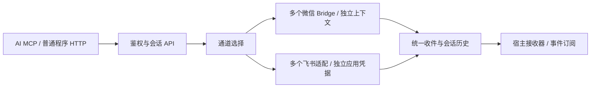

# 项目结构与维护约定

项目由两个可独立交付的组件组成：`server/` 是常驻服务，`mcp-plugin/` 是 AI 宿主的连接适配。项目根目录的 `docs/`、`scripts/` 和 `pytest.ini` 提供统一文档、发布与验证入口。

1.15.0 增加管理员统一管理的多个 Bot 与 Key 授权。`channels/registry.py` 保存 Bot、Key 授权列表及默认 Bot；`channels/` 按 `bot_id` 路由；`channels/wechat_store.py` 复用微信实现并隔离各 Bot 的绑定和运行状态；`channels/feishu/` 处理飞书认证、原生卡片与回调验证。会话、手机历史、任务答复和 `message.created` 事件共用，接入程序不要求是 AI。原 Key 只保留原默认微信 Bot 权限。

当前是单进程内的模块边界，不是微服务拆分。微信接收与存储中的既有耦合仍保留；未来通道及宿主可以沿这个边界增量接入，不为扩展目标立即重写整套服务。飞书当前采用 HTTPS 事件与卡片回调，长连接接收尚未接入。

## 服务器

所有运行时代码都在 `server/src/wechat_bridge/`，使用完整包名导入。`pyproject.toml` 将 Python 模块和页面资源一起打包，启动不依赖当前工作目录。

| 位置 | 职责 |
| --- | --- |
| `app.py` | 组装 FastAPI 应用和各路由 |
| `runtime/lifecycle.py` | 获取、启动和逆序释放资源；启动失败也执行清理 |
| `api/security.py` | 鉴权、异常映射、安全响应头 |
| `core/errors.py` | 通道无关的公共错误类型 |
| `channels/router.py`、`channels/drivers.py` | Bot 路由和内置通道能力注册 |
| `channels/feishu/inbound.py` | 飞书消息和卡片回调处理 |
| `config.py` | 公共 URL、Cookie 常量和静态资源根目录 |
| `api/admin.py` | 管理员密钥和扫码配对路由 |
| `api/clients.py` | 客户端消息、会话、图片、回执和事件游标 API |
| `api/portal.py` | 手机登录、历史、图片上传、回复、归档和删除路由 |
| `api/schemas.py` | 管理端和客户端请求模型 |
| `services/bridge.py` | 微信持续接收、发送、去重协调和空闲心跳 |
| `services/commands.py` | 微信文字指令和回复模板 |
| `services/portal.py` | 手机会话历史、登录状态和已读状态 |
| `storage/database.py` | SQLite 初始化、兼容迁移和持久化状态 |
| `storage/client_registry.py` | 客户端身份与密钥 |
| `storage/conversations.py` | 会话名称、状态与路由 |
| `storage/images.py` | 图片验证、规范化、额度与加密存储 |
| `wechat/protocol.py` | 微信域名校验、协议错误与响应语义 |
| `wechat/pairing.py` | 二维码配对和验证流程 |
| `mcp/server.py` | MCP 工具与认证组件的组装 |
| `mcp/oauth.py` | OAuth 授权、令牌与授权页面路由 |
| `mcp/events.py` | 事件订阅、回调签名和投递 |
| `mcp/tools.py` | 远程和 stdio 两端共用的工具定义原本 |
| `mcp/errors.py` | 两种传输共用的安全错误分类与恢复提示 |
| `frontend/src/admin/`、`frontend/src/chat/` | 管理页与手机页的维护源文件 |
| `web/admin/`、`web/chat/` | 构建后随 Python 包交付的静态资源 |
| `web/oauth/` | OAuth 授权页面 |
| `frontend/package-lock.json`、`frontend/THIRD-PARTY-NOTICES.md` | 前端依赖版本与第三方许可 |

这是一个单进程服务，数据库访问和业务协调沿用已有机制。`Store` 负责装配存储组件和会话服务；这些组件通过传入的 store 协作，不反向导入应用入口。当前并未强行改造成完全独立的领域层，也不支持通过增加 worker 数量扩容。

## 插件和共用文件

`mcp-plugin/server/` 保留脚本式入口，便于 AI 宿主用绝对路径启动 stdio 进程。它只调用服务端 API，不直接访问微信或数据库。插件独立分发时不依赖服务器源码。

以下文件由 `python scripts/sync_shared.py` 同步；发布前用 `--check` 检查：

- `server/src/wechat_bridge/mcp/errors.py` → `mcp-plugin/server/api_errors.py`
- `server/src/wechat_bridge/mcp/tools.py` → `mcp-plugin/server/toolkit.py`
- `docs/wechat-markdown/微信Markdown排版指南.md` → 插件 Skill 的 `references/wechat-markdown.md`

修改原本后运行同步工具，不要分别维护两份。插件版本与服务器版本独立；工具名称和默认值保持兼容，当前版本以各自包内元数据为准。

## 开发和发布

在项目根目录安装依赖，执行 README 中的测试命令。服务器单独使用时，在 `server/` 下执行 `python -m pip install .`，入口为 `wechat_bridge.app:app`。初始化脚本统一在 `server/scripts/`。

源码包用 `python scripts/build_release.py` 构建，采用公开目录和文件类型白名单，排除缓存、虚拟环境和私有运行目录。不要向公开源码目录存放真实密钥；打包规则不能替代发布前的内容审查。远程插件包仍由 `mcp-plugin/tools/build_remote_plugin.py` 构建。

运行数据、加密主密钥和 OAuth 令牌继续保存在部署者自己的数据目录及 secrets 中，绝不能打包进 GitHub。升级时备份数据库与对应加密密钥；代码备份无法代替数据备份。

## 前端构建边界

前端以 `frontend/` 为唯一维护源，通过 `python scripts/build_frontend.py` 生成运行资源。管理页、会话页和授权页采用 Vue 3 + Element Plus 独立入口，组件与组合式状态分离。会话页保留已验收的手势、草稿、附件与任务交互。检查命令的 `--check` 会拒绝源码与运行资源不同步。

本轮保持现有 API、数据库与包名兼容，不引入消息队列、多进程或微服务。存储中的微信协议相关部分仍是下一步可抽离的边界，不能仅凭文件迁移宣称完全解耦。
