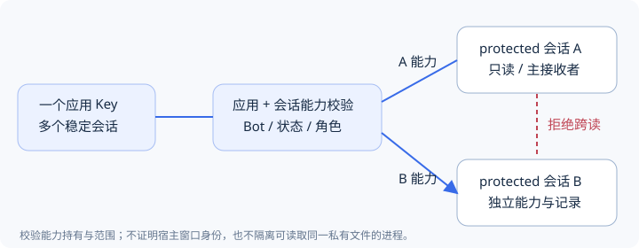
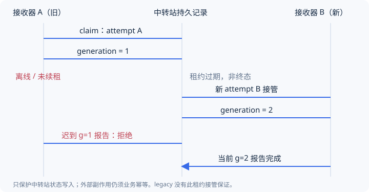

# AI 多会话通信与可靠收件

**原理解释 · 适用服务 1.18.0。** 假设同一个应用 Key 被两个 AI 聊天使用：构建助手等待发布确认，排障助手等待日志补充。消息“可以继续”属于谁？某个接收器离线一分钟，另一个能否接管？本页解释系统能保证的路由、能力和状态边界；具体配置步骤见[接收绑定操作](../integration/RECEIVERS.md)。

## 四个对象，两个不同的身份问题

| 对象 | 负责什么 | 不能证明什么 |
|---|---|---|
| 接入应用 / client_id | 稳定调用身份、Key/OAuth、Bot 授权 | 哪个 AI 聊天正在调用 |
| 通信连接 / bot_id | 具体微信账号或飞书应用与本人收件身份 | 调用方业务是否有权限执行 |
| 会话 / conversation_id | 持久消息归属与共享历史 | legacy 会话的独立接收身份 |
| 接收绑定 / receiver capability | protected 会话的主接收者或观察者能力 | 真实宿主窗口、用户进程或操作系统强隔离 |

一个应用可以动态登记多个会话，无需逐会话申请应用 Key。稳定 `conversation_key` 让重试登记复用会话；会话 ID 由服务返回。不要靠显示名或一个进程全局“当前会话”路由消息。



应用认证通过后，服务仍检查 Bot 授权和会话范围。protected 内容还要求对应的已验证接收能力；拿 A 的能力访问 B 会被拒绝。可读元数据不等于可读消息。只读观察者不能领取或报告工作。

能力保存在接收上下文的私有文件，适配器不把令牌返回给模型。`host_type=codex` 是标签，不是宿主证明；若同一系统用户下的其他进程能读取该文件，就不能声称两个真实聊天已形成强安全隔离。换宿主、能力丢失或过期时由管理员重新配对，不退回应用 Key 绕过校验。

## AI 主动与管理员主动创建

AI 主动创建前，先为实际接收上下文配置独立 `receiver_file`，再登记 protected 会话。第一次签发 setup 后由适配器保存并完成 challenge 验证；同键重试不会重新返回秘密。管理员主动创建可以先保存首条消息，再交付一次性私有配对文件，让接收端兑换和验证。未配对时首条消息仍保存，不能因为已保存就称 AI 已收到。

流程可概括为：

```text
管理员或 AI 登记会话 → 消息持久保存
接收端取得一次性 setup → 私有存储 → challenge 验证
应用认证 + 本会话能力 → 读取/领取 → 按实际工作报告
```

远程 MCP 不是天然具备私有接收存储：宿主若不能安全保管并转发能力头，就不能宣称 protected 接入完成。旧 legacy 会话保持原合同，但需要如实说明只有应用级范围。

## 准确路由先于“帮忙猜测”

平台入站先校验 Bot、应用和本人身份。飞书引用原通知时按上游消息 ID 找到原会话；完整回复标签也可以确定归属。没有明确引用的裸文本、未知或含糊标签保留待归属，**即使只剩一个待答任务，也不自动回答它**。

任务卡片还核对原任务、消息、会话和本人；重复同一决定不重复建入站，冲突决定拒绝。管理员归属操作需再次检查权限，不把已经直接归属的消息任意移到别的聊天。手机、管理端与原应用查看同一份已记录历史，但各自身份、草稿和已读含义不同。

## 五个不能混为一谈的事实

| 观察到的事实 | 可以得出的结论 | 不能得出的结论 |
|---|---|---|
| 本地消息 / 任务已保存 | 有可补查的记录 | 平台已发出、用户已读 |
| api_accepted / no_error_reported | 本次平台请求的接口层结果 | 手机响铃或已收件 |
| client_read | API 返回过该消息 | 已领取、已执行 |
| claimed / processing / completed | 应用领取并报告了进度 | 外部业务副作用恰好发生一次 |
| 事件订阅建立或回调 2xx | 事件通道的一步已完成 | 某个 AI 已自动醒来并回复 |

服务不把“成功保存”“成功调用”“业务完成”合并成一个绿色状态。发送端按原去重键查回执；接收端保存自己的游标、领取代际和业务幂等记录。

## 离线后如何继续，而不是漏掉旧消息

收件箱是持久数据，事件和唤醒只提供提示。短暂离线后用本会话上次持久化的 `after_id` 查询后续入站；首次查询可从 0 分页。每种查询范围分别维护游标，公共收件箱不是本会话的工作队列。

读取会写 client_read，但不会删除记录。一个安全顺序是：读取一批 → 将消息 ID 与原文安全入本地待处理记录 → 保存读取游标 → 对明确获授权的工作显式领取 → 执行并报告。也可以处理完再提交游标，但重启后必须容忍重复读取。不要只保存“最后看到的 ID”而丢弃尚未处理的消息。

历史接口用于完整已记录时间线，收件箱用于增量待处理输入；两者用途不同。历史不包含 AI 宿主未发给中转站的完整对话。服务器不能替调用程序持久保存它的外部业务事务。

## 租约和代际如何挡住迟到结果

**下图仅针对 protected 领取。legacy 的 generation=0、lease_expires=null，不提供同样的超时接管保证。**



接收器 A 领取后得到 `claim_id`、`generation` 和到期时间。长工作在到期前 renew。若 A 崩溃，租约过期后用新的领取 attempt/request_id 接管，代际递增；A 的迟到报告不能覆盖新代际。已经过期的旧 request_id 不能当作新接管请求反复提交。

```text
未领取 → claimed(g=1) → processing → completed / failed
              │ 租约过期且非终态
              └→ 新 attempt 接管(g=2) → 旧 g=1 续期/报告被拒绝
```

报告请求本身也有幂等键：同一报告 request_id 重试必须保持内容相同；新状态使用新的报告 ID。终态不可改写，也不因为 failed 就自动重做。先取得当前代际再决定后续处理，不能删 generation 绕过冲突。

**这不是恰好一次执行。** 若 A 已经调用外部系统、却在报告前崩溃，B 仍可能重复业务动作。调用方必须以 `inbox_id` 或业务事件 ID 在自己的系统实现幂等/对账；服务端 fencing 保护的是处理记录，不是任意外部事务。

## 订阅、归档、静音、停止分别处理

订阅有独立有效期和授权关系，需要续订；回调失败或订阅过期不意味着消息记录消失。重连后先确认绑定/授权，再补查收件箱，不能只等待下一个事件。事件能力、桌面接收器和不同宿主自动唤醒见[事件与唤醒](../server/MCP-EVENTS.md)，每个真实宿主另行验证。

| 操作 | 实际含义 | 不代表 |
|---|---|---|
| 新 UI 归档 | 改变列表可见性 | 关闭收发、停止监控进程 |
| 静音 | 保留正文/任务，抑制普通平台提醒 | 删除记录或撤销接收身份 |
| 结束外部监控 | 发结构化 stop_monitor，等待匹配领取/代际回执 | HTTP 200 就证明进程已停 |
| 旧 setConversationActive(false) | 保留旧关闭通信语义 | 与新归档操作等价 |

停止回执只证明获授权的接收端作了陈述，不能单凭它证明操作系统状态。没有回执保持待确认/超时；不要在界面上伪装已结束。

## 通知分流不改变安全边界

应用普通默认连接、会话偏好和获授权 urgent 连接属于发送策略。只有省略目标的请求进入策略选择；显式 Bot/平台继续原目标。stdio 默认会注入旧默认 Bot，需在私有配置中显式 `use_notification_policy=true` 才采用服务端策略。

普通请求不能借紧急连接绕过授权或限频。muted 仅表示普通提醒被抑制。备用只在未开始平台消息请求、连接停用或缺配置等允许条件下选择一次；未知结果和平台准备失败不自动改投。查询策略回执时保留原来省略的目标参数，不把返回的实际 Bot 补回请求。详见[通知路由](../server/BOTS.md#通知策略与原请求)。

## 证据和已知限制

实现锚点为 receivers、inbox_claims、lifecycle、notification_routing；现有测试分别覆盖同 Key 双会话拒绝、观察者、租约竞争/续期/迟到报告、离线停止、分流与未知结果不重投。[F02 验收索引](../f02/DELIVERY.md)保留历史范围；具体测试文件可在完整源码中核验。

R2 的特定 Codex 主动调用、R1/R3 真人收发与隔离恢复不能自动扩大为所有宿主的强身份或自动唤醒。新环境仍须逐层验收；不承诺无限保留、外部事务恰好一次或平台送达 SLA。
