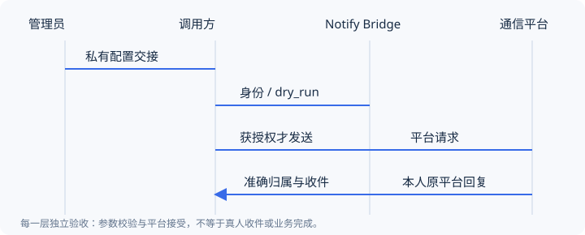

# 第一次接入 Notify Bridge

**教程 · 适用服务 1.18.0。** 目标：让一个已有业务程序，或一个 AI 助手，把一条无害通知送到已授权的本人连接，并读回同一会话的回复。本教程不启动内部 Agent，不让手机消息自动执行命令。

如果你只是收到文档网址，先读本页即可。阅读不需要管理登录；实际调用需要维护者提供接入配置。想查询字段而非从头操作，直接看 [API 参考与错误处理](../server/API.md)。

## 开始前准备什么

| 你是哪一方 | 必须具备 | 不需要交给接入方 |
|---|---|---|
| 站点管理员 | 可登录管理端；一个独立测试用微信或飞书连接；测试通知授权 | 不公开管理密码、Bot Secret、数据库、加密密钥 |
| 业务开发者 | 管理员提供的实际 base_url、有效应用 Key、授权 Bot ID；Python 3.12+ 可运行示例 | 不需要 SSH 或管理员账号 |
| AI 宿主使用者 | 支持工具调用的宿主；本机 MCP 包或实际 mcp_url/OAuth；受控私有配置位置 | 不把 Key、配对码或令牌贴入 AI 对话 |

使用生产服务前先取得该实例的测试授权，确认目标是本人。不要为了测试复用共享 Bot 回调或改变平台权限。没有这些资源时可以阅读、安装和 dry_run，**不能把这些步骤称为真人收件验证**。



上图的每个箭头需要自己的验证；中转站保存或平台接受，都不等于末端的人已收到。

## 1. 管理员准备一个可用连接

在管理端 **通信连接 → 新增通信连接** 选择平台。已有测试连接可直接复用，无需为每个程序或聊天新建 Bot。

1. 微信按向导扫码并在微信向 Bot 发一条消息；飞书填写本应用凭据和本人 Open ID，按[飞书操作指南](../server/新增飞书Bot操作指南.md)配置消息事件与卡片回调。
2. 保存后检查记录状态。**记录已创建、凭据已保存、真实收发已验证** 是三件事；待配置连接不可投递，失败后从原记录“继续配置”，不要反复新增。
3. 在获授权的测试窗口完成收发测试：本人看到通知，按提示从原平台回复，中转站记录回程。配置验证成功或平台接口 200 都不能代替本人收件。

**预期结果：** 连接已配置且未停用；所需真实通信另有验证记录。若飞书拒绝凭据，先核对 App Secret 与 Open ID 所属应用；不要跳过校验或改别人的 Bot。完整要求见[连接与授权](../server/BOTS.md)。

## 2. 管理员建立应用和发放资料

在 **接入应用** 创建一个稳定调用身份，例如 `build-monitor`，只授权本次需要的 Bot，设置默认连接。应用不是单个 AI 聊天：一把应用 Key 可以登记多个会话。

原始 Key 只在签发或轮换时展示，保存到受保护的位置。丢失时按原应用正常轮换；泄露时撤销该凭据，必要时停用应用。不能从服务器哈希找回原值，也不应为一次下载创建重复身份。

从 **帮助与接入** 选择对应的快速接入资料。拿到的资料要分清：

| 资料 | 用途 | 安全边界 |
|---|---|---|
| 公开文档 ZIP | Markdown、OpenAPI、示例、AI 索引 | 不含凭据，不是 MCP 程序 |
| HTTP 接入包 | 直接运行 Python 示例或参考 HTTP 合同 | 已配置文件可能含 Key，按私有文件保护 |
| 本机 MCP 包 | 由宿主启动 stdio 适配器 | 需准备 Python；私有配置不发给模型 |
| 远程 MCP 包 | 导入管理员提供的实际 mcp_url | 用户完成 OAuth；不能从 base_url 猜地址 |
| 仅规则 / Skill | 指导工具选择、收件和结果解释 | 规则本身没有连接或调用权限 |

**预期结果：** 调用方拿到实际地址、期望 client_id 和目标 Bot，凭据通过私有文件/受控环境交接。管理员密码、平台密钥不在包的公开部分。

## 3. 业务程序：先核对身份

下载文档 ZIP 并解压，在包含 `examples` 的根目录执行。若使用 HTTP 专用包，脚本在包根，命令中的 `examples/python/notify_bridge.py` 换成 `notify_bridge.py`。不需要安装 MCP 或额外 Python 库。

私有配置的**结构示意**如下，不能直接拿占位符调用。由维护者在本机编辑器填写并限制文件权限：

```json
{
  "base_url": "https://notify.example.com/bridge",
  "api_key": "CONFIGURE_SEPARATELY",
  "default_bot_id": "BOT_ID_FROM_ADMIN"
}
```

base_url 是服务根地址，不追加 `/api` 或 `/admin/`。Key 按字符串保存；示例域名和 Bot ID 不是有效部署配置。

```sh
python examples/python/notify_bridge.py --config "<私有配置文件绝对路径>" --identity-only
```

**预期结果：** 输出 `caller`、`client_id`、`bot_ids`、`default_bot_id`，与你拿到的身份一致。这一步只查询，不登记会话、不发送。401 时停止，检查 Key 是否过期/撤销或实际地址是否正确；身份或授权不符时让管理员修正，不能换其他 Key 绕过。

## 4. 登记会话并做不外发的检查

以下键只是格式示例；为自己的逻辑工作流选择一次并持久保存。不要每次启动随机换会话，也不要把项目名当作多个聊天共同的身份。

```sh
python examples/python/notify_bridge.py --config "<私有配置文件绝对路径>" --conversation-key demo-build-001 --event-id demo-build-001-notice
```

示例会查询身份、登记 legacy 会话，再显式发送 `dry_run:true` 的校验请求。保存返回的 `conversation_id` 和 `reply_tag`。输出片段应为：

```json
{"delivery":{"status":"dry_run_ready","sent_now":false,"network_checked":false}}
```

这不是完整响应，也不是平台连通性证明。API 自身的 `dry_run` 默认是 **false**；示例程序为了接入安全默认传 true。自己编写请求时不可遗漏它。

需要独立接收授权或领取超时恢复时，先完成[受保护会话流程](../integration/RECEIVERS.md)，不要把此 legacy 示例当成聊天安全隔离演示。

## 5. AI 助手：只选一条连接路径

本机使用包内 `INSTALL.md`：在解压插件目录运行 `python tools/configure_client.py --prepare`，再按[客户端安装](../integration/CLIENT-SETUP.md)导入生成的宿主配置。独立 ZIP 与带 marketplace 的网站包安装路径不同，不要混用。已有连接不重复安装。

远程方式使用 `CONNECTION.json` / `DEPLOYMENT.json` 的实际 `mcp_url`，由用户在宿主完成 OAuth；纯飞书实例可由管理员在“系统设置→手机端登录”生成一次性码，不需要先绑定微信。

让 AI 先调用 `getCallerIdentity` 核对身份，再为当前聊天登记稳定 `conversation_key`。接着在明确的会话和 Bot 下执行 dry_run。连接成功、Skill 已加载、通知可用、自动唤醒分别验收。[Skill 原文](../../mcp-plugin/skills/wechat-notify/SKILL.md)指导操作，服务端仍负责授权。

## 6. 获得许可后只发一条无害通知

确认前述身份、连接、测试窗口和收件人后，才在第 4 步命令末尾加 `--send`。正文固定为“通知桥接入测试”，无业务操作。此文档建设任务本身**不授权正式实例外发**。

不要只看 HTTP 200：`api_accepted` / `no_error_reported` 表示接口层结果；本人确认收到才记收件通过。发送超时或 `unconfirmed_do_not_retry` 时，使用原会话、原目标参数、原 `dedup_key` 查回执，先不要再发。查回执示例见[HTTP 接入](../integration/HTTP.md)。

## 7. 验证回复归属，而不是“AI 会自动回答”

微信按返回的 `reply_tag` 回复，或进入手机会话页；飞书引用这条通知回复，或使用完整标签。无明确引用的飞书裸文本留在待归属队列，不猜唯一待答任务。

在原应用读取 `GET /api/inbox`（MCP 为 `getMessages`），明确 `conversation_id` 与 `after_id`，确认回复的 Bot、正文和会话正确。示例 CLI 在 `--send` 后只读一次；之后的回复需要单独查询，不能因一次空列表就判定丢失。此查询不会启动长期轮询或自动唤醒 AI。

保存每会话游标；需要执行工作时才显式领取，业务完成后报告结果。外部回复和卡片答案不是执行任意命令的新授权。

## 8. 按这张表结束验收

| 检查 | 何时可以记通过 | 失败后下一步 |
|---|---|---|
| 身份 | 实际 status/client_id/授权 Bot 一致 | 修正私有配置或管理员授权 |
| 参数 | dry_run_ready 且 sent_now=false | 看 403/409/422 与具体 detail |
| 平台请求 | 查询原回执明确状态 | 按[错误处理](../server/API.md#错误处理与重试决策)分类，不盲重发 |
| 本人收件 | 本人实际确认正文/格式 | 检查平台、上下文和原消息回执 |
| 双向归属 | 原会话读到本人回复 | 核对引用/标签、Bot 授权、接收绑定及游标 |
| 自动唤醒 | 对应真实宿主自动处理且撤销后停止 | 单独检查宿主接收器/订阅；安装成功不算通过 |

只完成前两步时应写“身份和 dry_run 通过，真人通信未验证”。继续开发参考[HTTP 业务闭环](../integration/HTTP.md)、[多会话与可靠收件](../integration/RECEIVERS.md)和[API 参数合同](../reference/HTTP-CONTRACT.md)。
